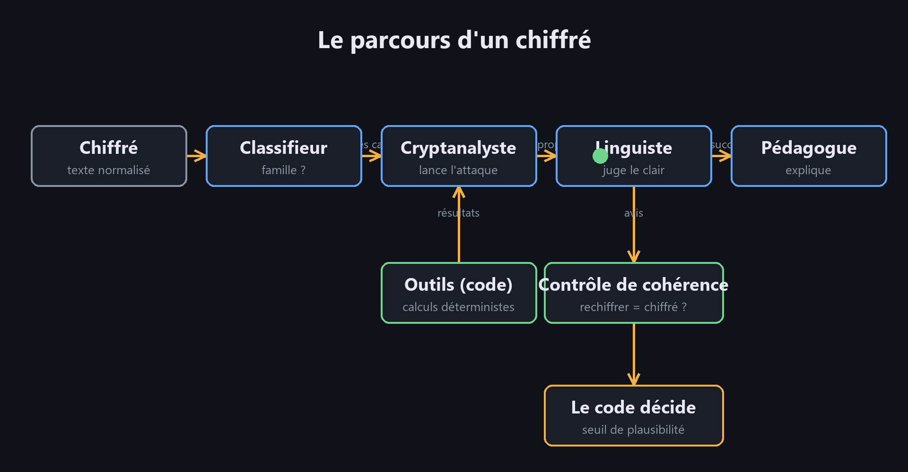
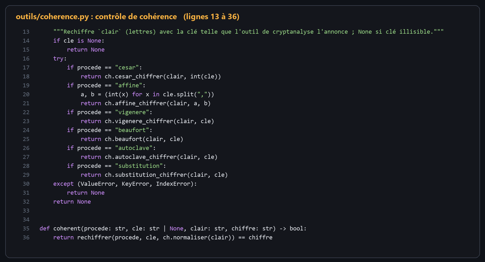
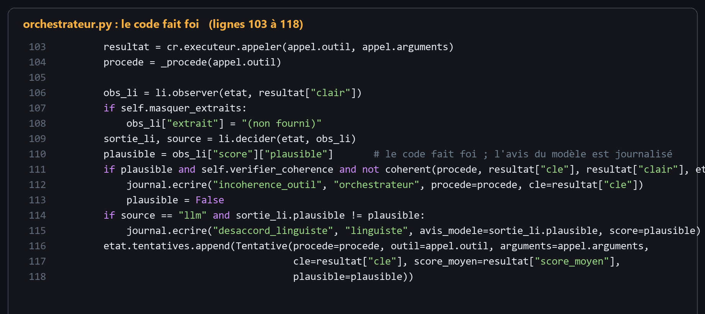
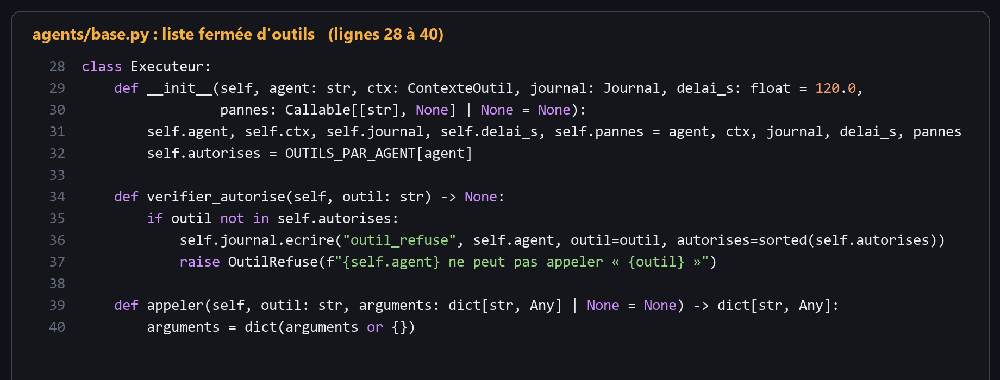
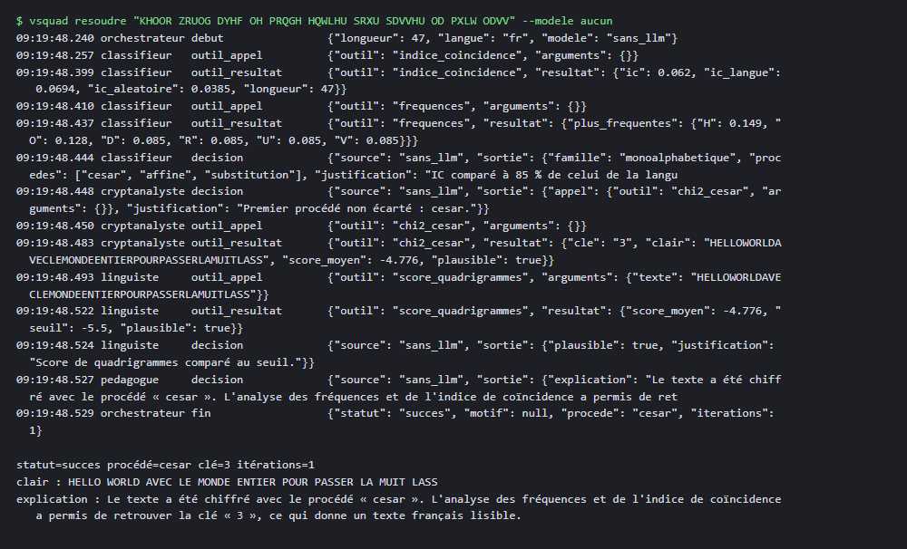
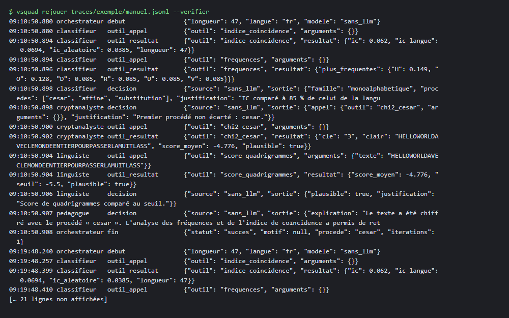
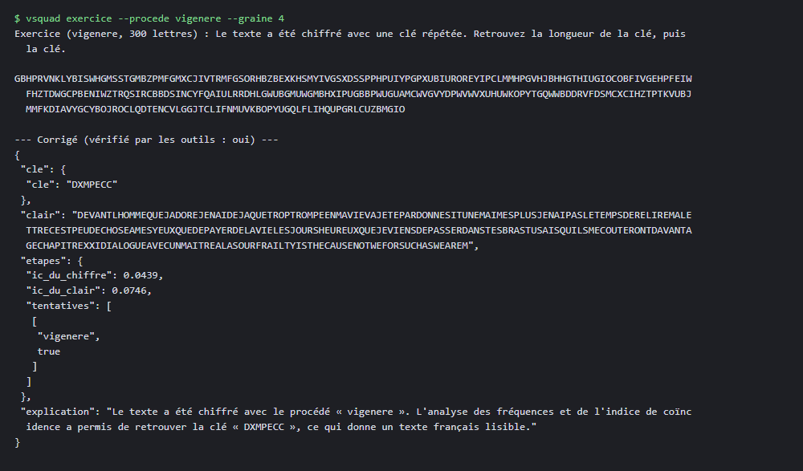

SUP DE VINCI · Mastère Cybersécurité

Vigenère-Squad

Cryptanalyse de chiffrements classiques par un système de quatre agents LLM encadrés

Projet individuel bonus, cours « Cryptographie appliquée et IA agentique »

SUP DE VINCI, année 2026, enseignant : Yulliwas AMEUR

**BENNAT Billal**

Sujet 1 : Vigenère-Squad. Version 1.0.0

Dépôt : https://github.com/Billal93/vigenere-squad

**Résumé.** Ce rapport présente Vigenère-Squad, un système qui casse automatiquement six chiffrements classiques (César, affine, Vigenère, Beaufort, autoclave et substitution simple) au moyen de quatre agents spécialisés pilotés par un orchestrateur explicite. Les opérations cryptographiques et statistiques sont confiées à des outils déterministes ; les modèles de langage, de petite taille et exécutés localement sur processeur, choisissent les outils dans des listes fermées et rédigent des explications, mais ne décident jamais seuls du succès d'une attaque. L'évaluation porte sur {{sans_llm.n}} chiffrés à graine fixe pour la référence sans modèle, et sur un échantillon volontairement minuscule pour les deux modèles testés (trois chiffrés avec trois répétitions pour le plus petit, un chiffré pour l'autre), parce que la machine n'a pas de carte graphique. Sans modèle, le système retrouve le clair exact pour {{sans_llm.taux_exact_global_pct|pct}} des chiffrés de la variante de base. Le rapport décrit aussi un modèle de menace du système lui-même, avec des contre-mesures dont l'effet est mesuré, et une ablation qui compare l'apport réel des agents à celui des outils seuls. Tous les nombres de ce document sont lus dans `results/metrics.json` au moment de la construction du PDF.

**Mots-clés :** cryptanalyse classique, indice de coïncidence, agents LLM, reproductibilité, ablation, sécurité des agents.

**Abstract.** This report presents Vigenère-Squad, a system that automatically breaks six classical ciphers (Caesar, affine, Vigenère, Beaufort, autokey and simple substitution) with four specialised agents driven by an explicit orchestrator. Cryptographic and statistical operations are delegated to deterministic tools; the small, locally-run language models only pick tools from closed lists and write explanations, and never alone decide whether an attack succeeded. The reference without any model is evaluated on {{sans_llm.n}} fixed-seed ciphertexts and recovers the exact plaintext for {{sans_llm.taux_exact_global_pct|pct}} of the base variant. Two models are evaluated on a deliberately tiny sample (three ciphertexts with three repetitions for the smaller one, one ciphertext for the other) because the machine has no GPU. The report also provides a threat model of the system itself, with measured countermeasures, and an ablation comparing the real contribution of agents to that of the tools alone. Every number in this document is read from `results/metrics.json` when the PDF is built.

[TOC]

# 1. Introduction

Les chiffrements classiques ont disparu de la pratique, mais ils restent un excellent terrain pour étudier ce que valent des agents fondés sur des modèles de langage lorsqu'on les applique à la cryptographie. Le problème y est bien posé : un texte chiffré, un ensemble connu de procédés, un critère de réussite objectif (retrouver le clair), et des outils statistiques éprouvés depuis plus d'un siècle. On peut donc vérifier chaque affirmation du système par un calcul, ce qui est précisément ce que l'on veut exiger d'un agent dans un domaine où une réponse plausible mais fausse a des conséquences.

La question posée par le cours est de savoir ce qu'apporte réellement une architecture multi-agents par rapport à un programme classique. Le présent projet y répond de façon empirique. Il construit d'abord un système complet et reproductible, ensuite il le fait tourner dans trois configurations (sans aucun modèle, avec un très petit modèle, avec un modèle de taille différente), enfin il compare les résultats. Il s'intéresse aussi à la sécurité du système lui-même, c'est-à-dire à ce qu'un texte déchiffré malveillant, un outil défaillant ou un modèle qui invente un appel d'outil peuvent provoquer.

Le travail est volontairement encadré par des règles d'intégrité. Aucune valeur chiffrée ne figure dans ce rapport sans provenir d'une exécution réelle consignée dans `results/metrics.json` ; les résultats défavorables sont publiés au même titre que les autres ; aucune opération cryptographique n'est déléguée à un modèle ; aucun secret n'est stocké dans le dépôt, les invites ou les traces. L'assistant de programmation Claude Code a écrit le code et les premières versions des textes à partir de mes instructions, ce que précise le fichier `AI_USAGE.md`.

Le plan est le suivant. La section 2 rappelle les procédés et les outils statistiques employés. La section 3 décrit l'architecture. La section 4 présente la méthode d'évaluation. La section 5 rapporte les résultats, la section 6 le modèle de menace et ses mesures, la section 7 discute de l'apport des agents et des limites. La section 8 détaille la reproductibilité, et la section 9 conclut.

# 2. Cadre : procédés et outils de cryptanalyse

## 2.1 Les six procédés

Tous les procédés opèrent sur l'alphabet latin de 26 lettres, après normalisation du texte (majuscules, suppression des accents, des espaces et de la ponctuation). Le chiffre de César décale chaque lettre d'un même nombre de positions. Le chiffre affine applique la transformation c = a·p + b modulo 26, avec a premier avec 26, ce qui laisse 312 clés. Le chiffre de Vigenère décale chaque lettre d'une valeur qui dépend de sa position modulo la longueur de la clé ; le chiffre de Beaufort est sa variante réciproque (c = k − p). L'autoclave utilise comme clé une amorce suivie du texte clair lui-même, de sorte que la clé ne se répète pas. La substitution simple remplace chaque lettre par une autre selon une permutation de l'alphabet, soit 26! clés.

## 2.2 Reconnaître la famille : indice de coïncidence

L'indice de coïncidence d'un texte est la probabilité que deux lettres tirées au hasard soient identiques. Il vaut environ 0,0746 pour le français, 0,0667 pour l'anglais et 1/26 ≈ 0,0385 pour un texte uniformément aléatoire. Les procédés monoalphabétiques (César, affine, substitution) préservent l'indice du clair, alors que les procédés polyalphabétiques le rapprochent de la valeur aléatoire, d'autant plus que la clé est longue. Cette seule mesure permet déjà au Classifieur de séparer deux familles.

## 2.3 Longueur de clé : Kasiski, Friedman, indice par colonne

Pour un chiffre polyalphabétique à clé répétée, la méthode de Kasiski repère des séquences répétées dans le chiffré et regarde les écarts entre leurs occurrences : la longueur de clé divise souvent ces écarts. Le test de Friedman estime la longueur à partir de l'indice de coïncidence global. Le système utilise surtout une méthode par colonnes : pour chaque longueur candidate L, on découpe le texte en L colonnes et on calcule l'indice moyen de colonne ; on retient la plus petite longueur dont l'indice atteint 90 % du meilleur. Si l'indice global dépasse 85 % de celui de la langue, la longueur 1 est retenue (cas monoalphabétique).

## 2.4 Retrouver la clé

Pour César, un test du χ² entre les fréquences observées et celles de la langue donne le décalage. Pour l'affine, une recherche exhaustive des 312 clés est notée par un modèle de quadrigrammes. Pour Vigenère et Beaufort, une fois la longueur connue, chaque colonne est un César (ou son opposé), résolu par χ². Pour l'autoclave, Kasiski ne s'applique pas puisque la clé ne se répète pas : une montée de colline sur les lettres de l'amorce, guidée par le score de quadrigrammes du texte entier, la retrouve. Pour la substitution, un recuit simulé explore l'espace des permutations, noté par le même score.

## 2.5 Juger un clair : modèle de quadrigrammes

Le Linguiste s'appuie sur un modèle de langue par quadrigrammes de lettres, appris sur des livres de Project Gutenberg, avec un plancher de probabilité de 0,01 occurrence pour les quadrigrammes jamais vus. Le score d'un texte est le logarithme décimal moyen de la probabilité d'un quadrigramme. Les livres qui servent à apprendre le modèle sont disjoints de ceux dont on tire les clairs de test. Un seuil de plausibilité de −5,5 a été calibré sur ces données : les clairs réels obtiennent au moins −4,6 et les mauvaises hypothèses au plus −7,6, ce qui laisse une marge confortable de part et d'autre.

## 2.6 Distance d'unicité

Shannon définit la distance d'unicité d'un chiffrement comme la longueur de texte à partir de laquelle une seule clé reste compatible avec un clair de la langue : U = H(K) / D, où H(K) est l'entropie de la clé et D la redondance du clair par lettre. Pour une clé de Vigenère de longueur k, H(K) = k·log₂ 26. Cette quantité sert de borne de référence à la section 5.4, où l'on confronte la longueur minimale réellement nécessaire à l'attaque à cette valeur théorique.

# 3. Architecture du système

## 3.1 Vue d'ensemble

Le système est un programme Python dont l'orchestrateur est écrit explicitement : il ne laisse pas un modèle décider de l'ordre d'exécution. Il maintient un état partagé typé (modèles Pydantic) qui contient le chiffré normalisé, la famille supposée, les procédés déjà écartés, les tentatives et le statut. À chaque itération, il consulte successivement le Classifieur, le Cryptanalyste et le Linguiste. Si le Linguiste juge le clair plausible, la boucle s'arrête et le Pédagogue explique la démarche. Sinon, le procédé est écarté et le Classifieur est reconsulté, dans la limite de quatre itérations.

*Figure : le parcours d'un chiffré. Les éléments verts sont du code déterministe.*

## 3.2 Les quatre agents

Chaque agent possède un prompt système versionné (fichier `prompts/<agent>.v1.md`), une liste fermée d'outils et un schéma de sortie JSON validé par Pydantic. Le tableau suivant résume leurs rôles.

| Agent | Rôle | Outils autorisés |
|---|---|---|
| Classifieur | proposer la famille et les procédés candidats | indice de coïncidence, fréquences |
| Cryptanalyste | choisir l'attaque et ses paramètres | Kasiski, Friedman, longueur par indice, χ² de César, force brute affine, attaques Vigenère, Beaufort, autoclave, substitution |
| Linguiste | juger la plausibilité du clair | score de quadrigrammes |
| Pédagogue | expliquer la démarche à un étudiant | aucun |

## 3.3 Ce que le modèle ne fait pas

Trois dispositions limitent le rôle du modèle. D'abord, le texte chiffré n'est jamais transmis par les arguments que le modèle écrit : l'exécuteur d'outils l'injecte depuis le contexte, le modèle ne fournit que des paramètres comme une longueur de clé. Ensuite, la décision de plausibilité appartient au code : le score de quadrigrammes est calculé par l'outil et comparé au seuil, l'avis du Linguiste étant seulement journalisé s'il diverge. Enfin, un contrôle de cohérence rechiffre le clair proposé avec la clé annoncée et exige de retrouver exactement le chiffré, ce qui écarte un résultat d'outil falsifié même si le texte proposé est du français parfait.

Le contrôle de cohérence est du code : il rechiffre le clair annoncé avec la clé annoncée.

L'orchestrateur applique ce contrôle avant d'accepter une hypothèse ; l'avis du modèle n'est que journalisé.

## 3.4 Robustesse aux défaillances

Quand le modèle renvoie un JSON invalide, une réponse vide ou un objet qui ne respecte pas le schéma, l'agent réessaie une fois puis se replie sur sa décision déterministe, ce que la trace mentionne. Un appel à un outil hors de la liste de l'agent est refusé avant exécution, journalisé sous le type `outil_refuse`, et traité comme une réponse invalide. Un outil en panne ou trop lent déclenche une reprise puis un abandon propre. Ces comportements sont couverts par des tests d'injection de pannes.

## 3.5 Traçabilité

Chaque message envoyé au modèle, chaque réponse, chaque appel d'outil, chaque refus et chaque décision est écrit dans un fichier JSONL horodaté, un par chiffré. La commande `vsquad rejouer` relit une trace, et avec l'option `--verifier` contrôle que chaque appel d'outil figure bien dans la liste de son agent.

Une résolution sans modèle d'un chiffré de César, puis le rejeu de la trace avec vérification des listes d'outils.

## 3.6 Le Pédagogue et les exercices

Au-delà de l'explication, le Pédagogue sait générer des exercices. À partir d'un clair du corpus, d'un procédé et d'une graine, le système tire une clé, chiffre le texte, puis exécute l'orchestrateur sans modèle pour produire le corrigé. L'exercice n'est publié que si le clair retrouvé est identique au clair d'origine ; sinon il est rejeté et un autre est tiré. Une seconde fonction, indépendante, revérifie tout exercice publié en rechiffrant le clair du corrigé avec la clé du corrigé et en recalculant les valeurs d'indice de coïncidence qui y figurent.

# 4. Méthode d'évaluation

## 4.1 Corpus

Le corpus est généré à graine fixe (42) à partir d'extraits de livres de Project Gutenberg, dont les empreintes SHA-256 sont vérifiées. Pour chacun des six procédés et chacune des six longueurs de texte (80, 150, 300, 600, 1000 et 2000 lettres), cinq chiffrés sont produits, soit 180 chiffrés par variante. Quatre variantes sont évaluées : la base en français, une variante sans espaces ni ponctuation, une variante avec 5 % de fautes de frappe dans le chiffré, et une variante en anglais. Le système normalise le texte avant toute analyse ; on s'attend donc à ce que la variante sans espaces donne exactement les mêmes résultats que la base, ce que l'on vérifie.

## 4.2 Mesures

Pour chaque chiffré on enregistre le clair obtenu, le procédé reconnu, la clé, le nombre d'itérations, le temps écoulé et le pic de mémoire Python. Les mesures publiées sont : le pourcentage de clairs exacts par procédé et par tranche de longueur ; la plus petite longueur à partir de laquelle toutes les tranches atteignent 90 % de succès ; le nombre moyen d'itérations ; le temps et la mémoire par chiffré ; la proportion de chiffrés dont la famille est correctement reconnue ; enfin, pour les explications, une grille de dix critères binaires appliquée à dix explications tirées au hasard.

## 4.3 Trois configurations pour l'ablation

La configuration (a) n'utilise aucun modèle : l'orchestrateur est le même, mais chaque agent prend sa décision déterministe. La configuration (b) utilise `qwen3:0.6b`, très petit modèle. La configuration (c) utilise `qwen3:4b`, modèle de taille différente. Les deux modèles tournent via Ollama 0.40.13, sur processeur uniquement, avec une température de 0,3, un contexte de 8192 jetons, des graines 43, 44 et 45 pour les trois répétitions, et une sortie contrainte par schéma JSON. Leurs empreintes (digests) sont consignées dans `config/experiment.yaml` et vérifiées par `scripts/verifier_modeles.py`. Le modèle `qwen3:8b` a été téléchargé mais n'est pas évalué : à quelques jetons par seconde sur cette machine, l'évaluation aurait dépassé toute durée raisonnable. Le modèle de 4 milliards de paramètres n'est évalué que sur un chiffré.

## 4.4 Le protocole réduit pour les modèles

La machine d'évaluation, décrite dans `results/ENVIRONMENT.json`, est un ordinateur à processeur Intel de {{environnement.systeme.coeurs_logiques|n0}} cœurs logiques et {{environnement.systeme.ram_totale_go|n1}} Go de mémoire, sans carte graphique exploitable. Les modèles y sont lents : un chiffré de 300 lettres demande de une à plus de quatre minutes. Mon objectif est de montrer que le concept fonctionne, pas de mesurer des taux précis ; j'ai donc réduit les évaluations avec modèle à quelques minutes de calcul par configuration. Le très petit modèle est évalué sur trois chiffrés de 300 lettres (un César, un Vigenère, une substitution simple), trois fois chacun. Le modèle de 4 milliards de paramètres est évalué sur un seul chiffré, une seule fois. L'expérience d'injection porte sur deux chiffrés. La référence sans modèle est évaluée sur les 720 chiffrés et aussi sur les mêmes chiffrés que chaque configuration avec modèle, ce qui rend la comparaison équitable. Aucun pourcentage obtenu avec un modèle n'a de valeur statistique. Les limites de ce protocole sont rappelées dans la discussion.

## 4.5 Intégrité de l'évaluation

Les mesures brutes sont écrites au fil de l'eau dans `results/raw/*.jsonl` ; `metriques.py` les agrège en `metrics.json` sans valeur saisie à la main, et ce rapport lit ses nombres dans ce fichier. Les résultats défavorables ne sont ni retirés ni retouchés. Lorsqu'une exécution a été perturbée, par exemple par une mise en veille de l'ordinateur qui fausse un temps de calcul, le fait est signalé à la section concernée plutôt que corrigé en silence.
