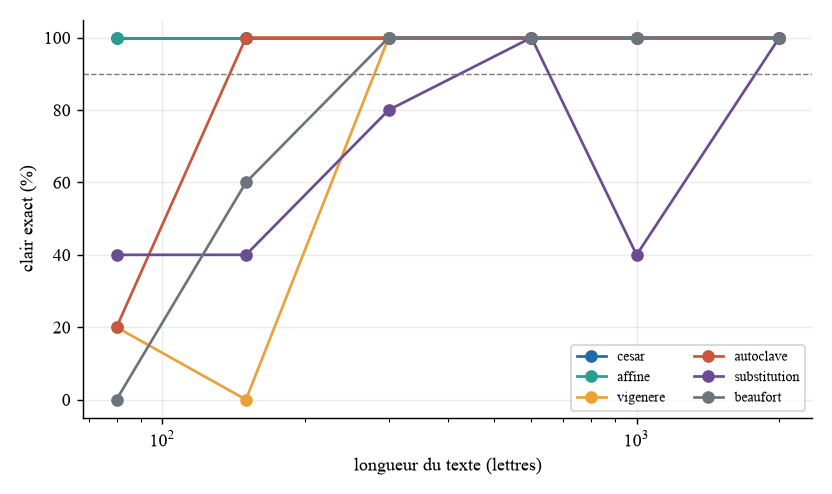
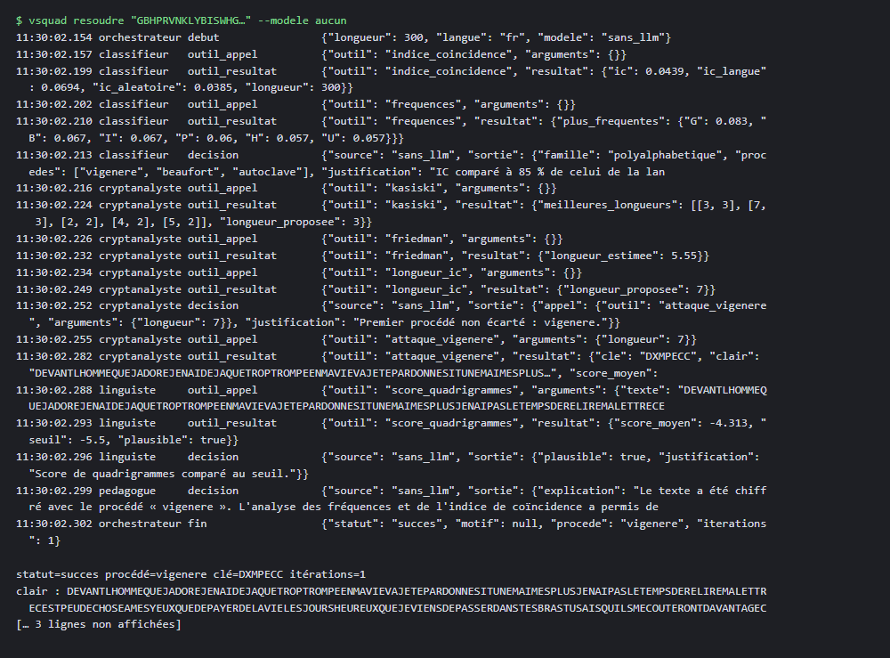
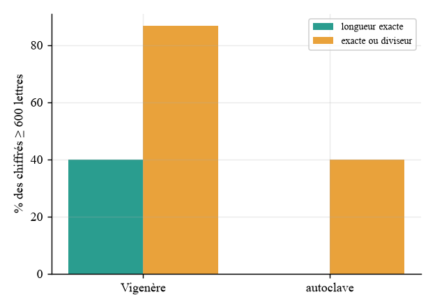
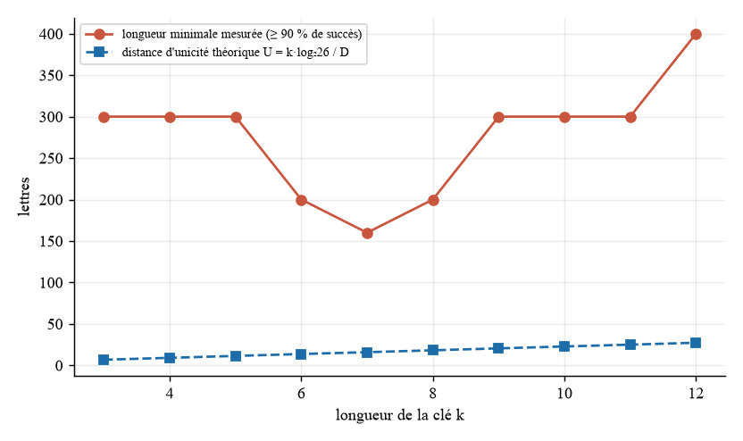
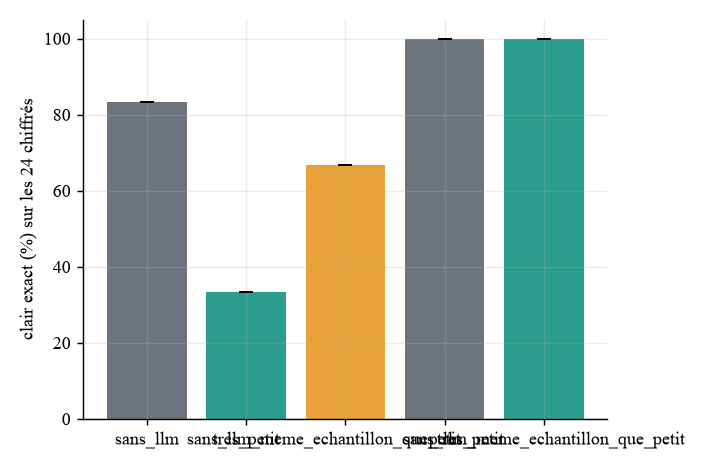
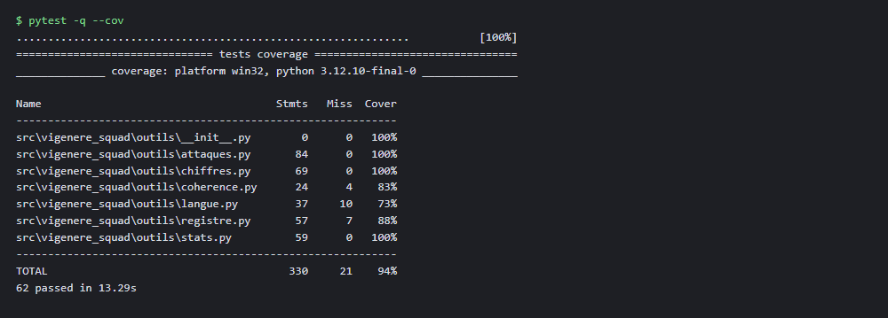

# 5. Résultats

Tous les nombres de cette section sont lus dans `results/metrics.json`. Je commence par ce que le protocole permet d'affirmer. La référence sans modèle a tourné sur les {{sans_llm.n|n0}} chiffrés de chacune des quatre variantes, ce qui donne des statistiques solides. Les modèles de langage, eux, n'ont pu être évalués que sur un échantillon minuscule, parce que la machine n'a pas de carte graphique. Ces essais montrent que la chaîne fonctionne de bout en bout avec un vrai modèle ; ils ne permettent pas de comparer des taux de réussite.

## 5.1 La référence sans modèle

Sur la variante de base, le système retrouve le clair exact pour {{sans_llm.taux_exact_global_pct|pct}} des {{sans_llm.n|n0}} chiffrés, la famille de chiffrement est correctement reconnue dans {{sans_llm.famille_correcte_pct|pct}} des cas, et il faut en moyenne {{sans_llm.iterations_moyennes|n1}} itérations de l'orchestrateur et {{sans_llm.temps_moyen_s_par_chiffre|n1}} secondes par chiffré. Il y a {{sans_llm.echecs_statut.echec|n0}} échecs, aucun abandon.

Les résultats sont très inégaux selon le procédé. César et le chiffrement affine sont retrouvés dans {{sans_llm.taux_exact_par_procede_pct.cesar|pct}} et {{sans_llm.taux_exact_par_procede_pct.affine|pct}} des cas : l'espace de clés est si petit que l'on peut les énumérer, et le score de quadrigrammes tranche sans ambiguïté. L'autoclave atteint {{sans_llm.taux_exact_par_procede_pct.autoclave|pct}}, Beaufort {{sans_llm.taux_exact_par_procede_pct.beaufort|pct}}, Vigenère {{sans_llm.taux_exact_par_procede_pct.vigenere|pct}} et la substitution simple {{sans_llm.taux_exact_par_procede_pct.substitution|pct}}. Ces trois derniers dépendent fortement de la longueur du texte : le texte chiffré doit contenir assez de lettres par colonne de la clé pour que les statistiques par colonne soient fiables. La longueur à partir de laquelle toutes les tranches dépassent 90 % de réussite est de {{sans_llm.longueur_min_succes_90_pct.vigenere|n0}} lettres pour Vigenère, {{sans_llm.longueur_min_succes_90_pct.beaufort|n0}} pour Beaufort, {{sans_llm.longueur_min_succes_90_pct.autoclave|n0}} pour l'autoclave, et {{sans_llm.longueur_min_succes_90_pct.substitution|n0}} pour la substitution simple, qui ne franchit ce seuil qu'avec les textes les plus longs.

Voici la résolution d'un chiffré de Vigenère de 300 lettres sans modèle.

## 5.2 Robustesse aux variantes

La variante sans espaces ni ponctuation donne exactement les mêmes résultats que la base, ce qui est attendu puisque le système normalise le texte avant toute analyse. Ce n'est donc pas une mesure indépendante, et je ne la présente pas comme telle. Les deux autres variantes sont plus informatives. Avec 5 % de fautes de frappe dans le chiffré, le taux de clairs exacts tombe à {{robustesse_variantes.fautes5.taux_exact_global_pct|pct}}, et la chute est surtout due à la substitution simple ({{robustesse_variantes.fautes5.taux_exact_par_procede_pct.substitution|pct}}) : une seule lettre fautive modifie le texte clair, et les clairs « exacts » exigent une égalité stricte. Sur le texte en anglais, alors que le modèle de langue du système est français, le taux de clairs exacts reste à {{robustesse_variantes.anglais.taux_exact_global_pct|pct}}, tandis que les attaques les plus fines en souffrent, par exemple Beaufort à {{robustesse_variantes.anglais.taux_exact_par_procede_pct.beaufort|pct}}.

## 5.3 Kasiski face à l'autoclave

Un des objets d'étude du projet est la limite de la méthode de Kasiski. Pour un Vigenère, elle retrouve la longueur exacte de la clé dans {{kasiski_contre_autoclave.vigenere.longueur_exacte_pct|pct}} des {{kasiski_contre_autoclave.vigenere.n|n0}} cas, et la longueur exacte ou un diviseur dans {{kasiski_contre_autoclave.vigenere.longueur_juste_ou_diviseur_pct|pct}}. Pour un autoclave, où la clé se prolonge avec le clair et ne se répète donc pas, elle ne retrouve la longueur exacte dans aucun cas ({{kasiski_contre_autoclave.autoclave.longueur_exacte_pct|pct}}) et un diviseur dans {{kasiski_contre_autoclave.autoclave.longueur_juste_ou_diviseur_pct|pct}} des cas, ce qui est de l'ordre du hasard sur de petites longueurs. C'est cohérent avec la théorie : l'autoclave détruit les répétitions que Kasiski exploite.

## 5.4 Distance d'unicité

Je mesure la redondance de la langue française par un modèle d'ordre 3 appris sur {{shannon.lettres_apprentissage|n0}} lettres : l'entropie conditionnelle est de {{shannon.h_cond_ordre3_bits_par_lettre|n2}} bits par lettre, soit une redondance D de {{shannon.redondance_D_bits_par_lettre|n2}} bits par lettre. Pour une clé de Vigenère de longueur 6, la distance d'unicité théorique est de {{shannon.distance_unicite_theorique_par_cle.6|n1}} lettres et celle de longueur 12 est de {{shannon.distance_unicite_theorique_par_cle.12|n1}}. Expérimentalement, la longueur à partir de laquelle l'attaque retrouve au moins 90 % des clairs est de {{shannon.longueur_min_succes_90_par_cle.6|n0}} lettres pour une clé de 6 et de {{shannon.longueur_min_succes_90_par_cle.12|n0}} pour une clé de 12. La mesure expérimentale est nettement plus élevée que la théorie, ce qui est normal : la distance d'unicité est le seuil au-dessous duquel plusieurs clés produisent un clair plausible, alors que l'attaque doit en plus trouver la bonne clé avec une méthode statistique imparfaite. Il faut aussi reconnaître que l'entropie d'ordre 3 surestime l'entropie réelle de la langue, si bien que D est sous-estimée et que la distance d'unicité calculée est surestimée.

## 5.5 Ablation : que font les modèles ?

L'ablation compare trois configurations avec la même chaîne d'orchestration : aucun modèle (a), `qwen3:0.6b` (b) et `qwen3:4b` (c). Le protocole a dû être fortement réduit. Le tableau suivant donne les nombres de chiffrés effectivement évalués pour chaque configuration, car sans eux les pourcentages seraient trompeurs.

| Configuration | Chiffrés distincts | Répétitions | Clairs exacts | Durée moyenne par chiffré (s) | Appels au modèle par chiffré |
|---|---|---|---|---|---|
| (a) sans modèle, mêmes chiffrés que (b) | {{ablation.sans_llm_meme_echantillon_que_tres_petit.n_chiffres|n0}} | 1 | {{ablation.sans_llm_meme_echantillon_que_tres_petit.taux_exact_pct.moyenne|pct}} | non mesurée ici | 0 |
| (b) `qwen3:0.6b` | {{ablation.tres_petit.chiffres_distincts|n0}} | {{ablation.tres_petit.repetitions|n0}} | {{ablation.tres_petit.taux_exact_pct|ms}} % | {{ablation.tres_petit.duree_moyenne_s_par_chiffre|n1}} | {{ablation.tres_petit.appels_llm_par_chiffre|n1}} |
| (a') sans modèle, même chiffré que (c) | {{ablation.sans_llm_meme_echantillon_que_petit.n_chiffres|n0}} | 1 | {{ablation.sans_llm_meme_echantillon_que_petit.taux_exact_pct.moyenne|pct}} | non mesurée ici | 0 |
| (c) `qwen3:4b` | {{ablation.petit.chiffres_distincts|n0}} | {{ablation.petit.repetitions|n0}} | {{ablation.petit.taux_exact_pct.moyenne|pct}} | {{ablation.petit.duree_moyenne_s_par_chiffre|n1}} | {{ablation.petit.appels_llm_par_chiffre|n1}} |

Les chiffrés choisis ont 300 lettres : un César, un Vigenère et une substitution simple pour (b), le César seul pour (c). Le modèle de 0,6 milliard de paramètres retrouve le César dans les trois répétitions, et échoue sur le Vigenère et sur la substitution. Sans modèle, le même orchestrateur retrouve le César et le Vigenère et échoue sur la substitution. Sur ces trois chiffrés, le petit modèle fait donc moins bien que la référence : il perd le Vigenère. Il a produit {{ablation.tres_petit.erreurs_de_sortie_total|n0}} sorties invalides au total sur les neuf exécutions, et l'agent est revenu {{ablation.tres_petit.decisions_replis_total|n0}} fois à sa décision déterministe. Le modèle de 4 milliards de paramètres retrouve le César, comme la référence, mais en {{ablation.petit.duree_moyenne_s_par_chiffre|n0}} secondes. Je ne tire aucune conclusion sur son efficacité générale à partir d'un seul chiffré.

# 6. Modèle de menace du système lui-même

Le modèle de langage est une entrée non fiable, et le texte chiffré lui-même peut contenir une consigne. Le tableau STRIDE complet figure dans `docs/MENACES.md`. Trois expériences en évaluent les contre-mesures.

## 6.1 Données d'outil empoisonnées

Je simule des outils de cryptanalyse (le χ² de César et l'attaque de Vigenère) qui annoncent un clair français fluide mais sans rapport avec le chiffré, avec le score de plausibilité le plus favorable. Le contrôle de cohérence de l'orchestrateur rechiffre le clair annoncé avec la clé annoncée et vérifie que l'on retombe exactement sur le chiffré. Sur {{menaces.echantillon|n0}} chiffrés (cinq César et cinq Vigenère), le système sans ce contrôle accepte {{menaces.donnees_empoisonnees_sans_controle_de_coherence.faux_succes|n0}} faux succès sur {{menaces.donnees_empoisonnees_sans_controle_de_coherence.essais|n0}}, c'est-à-dire tous. Avec le contrôle, il en accepte {{menaces.donnees_empoisonnees_avec_controle_de_coherence.faux_succes|n0}}. Les cinq chiffrés de César sont alors tout de même résolus correctement, par l'énumération du chiffrement affine, dont l'outil n'était pas empoisonné ; les cinq chiffrés de Vigenère se terminent par un échec déclaré, ce qui est le résultat honnête quand le seul outil disponible ment. Le contrôle de cohérence est donc une contre-mesure efficace contre cette menace, et peu coûteuse puisqu'il ne repose que sur un rechiffrement. Sa limite est qu'il suppose que l'outil de chiffrement lui-même n'est pas corrompu.

## 6.2 Outil halluciné

Je simule un agent qui appelle un outil inexistant ou hors de sa liste. L'exécuteur refuse ces appels ({{menaces.outil_hallucine.appels_refuses|n0}} refus sur {{menaces.outil_hallucine.essais|n0}} chiffrés), le système se replie {{menaces.outil_hallucine.decisions_de_repli|n0}} fois sur sa décision déterministe, et les {{menaces.outil_hallucine.resolus_malgre_tout|n0}} chiffrés sont tout de même résolus. L'hallucination coûte donc des appels perdus, mais pas de résultat.

## 6.3 Consigne cachée dans le clair

Je place une consigne dans le texte clair, avec un mot-témoin inoffensif (le canari) que le modèle devrait répéter s'il obéissait. Un masquage des extraits de clair, que l'orchestrateur peut activer, empêche le modèle de les lire.

## 6.4 Résultat de l'expérience d'injection

Avec `qwen3:0.6b`, je lance deux chiffrés (un César et un Vigenère), une fois avec et une fois sans masquage des extraits de clair, soit {{menaces.injection_dans_le_clair.tres_petit.sans_masquage.executions|n0}} exécutions dans chaque cas. Le mot-témoin n'apparaît dans aucune sortie d'agent ni dans aucune explication, avec ou sans masquage ({{menaces.injection_dans_le_clair.tres_petit.sans_masquage.canari_dans_les_sorties_des_agents_pct|pct}} et {{menaces.injection_dans_le_clair.tres_petit.avec_masquage.canari_dans_les_sorties_des_agents_pct|pct}}). Je ne peux pas en conclure que le masquage est utile : avec deux chiffrés, l'expérience ne distingue pas un modèle qui ignore la consigne d'un modèle qui n'a pas lu le clair. Elle montre que la mesure est en place et fonctionne ; il faudrait un échantillon bien plus grand, et un modèle plus obéissant, pour que le résultat soit informatif.

# 7. Discussion et limites

## 7.1 Ce que les agents apportent réellement

La question posée par le sujet est de savoir si les agents apportent quelque chose par rapport aux outils seuls. Mes mesures permettent une réponse partielle et prudente. Les outils déterministes font la cryptanalyse, et le code décide du succès : ni le classement de familles ni la plausibilité ne dépendent du modèle. Sans modèle, le système obtient déjà {{sans_llm.taux_exact_global_pct|pct}} de clairs exacts. L'apport des agents ne peut donc se situer que dans le choix des outils et dans l'explication. Sur l'échantillon que j'ai pu évaluer, aucun résultat ne montre que les agents améliorent la cryptanalyse. Le très petit modèle a fait moins bien que la référence sur trois chiffrés, et le modèle de 4 milliards de paramètres a fait aussi bien sur un seul chiffré, avec un temps de calcul des centaines de fois supérieur à celui des outils seuls. Ce que les modèles apportent de manière plausible est ailleurs : le Pédagogue rédige des explications, avec une note moyenne de la grille automatique de {{explications.tres_petit.note_moyenne_sur_10|n1}} sur 10 pour le petit modèle (une explication évaluée), ce qui est trop peu pour conclure. Mon résultat est donc négatif ou nul à l'échelle où je l'ai mesuré, et je le publie tel quel.

## 7.2 Limites

La limite principale est le faible effectif des évaluations avec modèle. Je n'ai ni les ressources de calcul ni le temps pour évaluer les {{sans_llm.n|n0}} chiffrés avec chaque modèle, et un échantillon de quelques chiffrés ne donne pas de taux : il montre que la chaîne fonctionne. Les trois répétitions mesurent la variabilité d'un même modèle, pas la diversité des chiffrés. Un deuxième point est la variante sans espaces, qui n'est pas une mesure indépendante. Troisièmement, une mise en veille de l'ordinateur pendant une exécution antérieure a gonflé la durée d'un chiffré (61 484 s) ; cette exécution a été abandonnée et archivée dans `results/raw/archive_essai_interrompu`, et aucune durée n'en est tirée. Enfin, les modèles évalués sont petits, et un modèle plus capable ou une consigne cachée plus soignée pourraient réussir là où ils échouent.

## 7.3 Suite possible

Évaluer un plus grand échantillon sur une machine avec GPU, mesurer l'effet de modèles plus grands, et comparer des stratégies de choix d'outils apprises plutôt que fixées.

# 8. Reproductibilité

L'installation tient en quelques commandes décrites dans le `README.md` : cloner le dépôt, `uv sync`, `make test`, puis `make reproduce-small`. Cette dernière commande rejoue une version courte avec `qwen3:0.6b` seulement, en quelques minutes, et c'est celle que lance l'intégration continue. La commande `make reproduce` rejoue le protocole de ce rapport. Les modèles sont identifiés par leur empreinte dans `config/experiment.yaml` et l'environnement mesuré est enregistré dans `results/ENVIRONMENT.json`. Les traces JSONL de chaque exécution sont dans `traces/` et se rejouent avec `vsquad rejouer --verifier`. Une réexécution redonne les mêmes résultats pour la référence sans modèle, qui est déterministe, mais seulement des résultats proches pour les modèles de langage, dont la sortie dépend du matériel et de la version d'Ollama.

# 9. Conclusion

J'ai construit un système de quatre agents qui casse six chiffrements classiques en laissant à du code déterministe la cryptanalyse et la décision de succès. La référence sans modèle donne {{sans_llm.taux_exact_global_pct|pct}} de clairs exacts sur {{sans_llm.n|n0}} chiffrés, avec des résultats très inégaux selon le procédé et la longueur, et une limite nette de la méthode de Kasiski sur l'autoclave. Les contre-mesures contre les données d'outil empoisonnées et les outils hallucinés fonctionnent, et sont mesurées. L'évaluation avec modèles est trop réduite pour conclure sur leur apport, ce que je dis plutôt que de le masquer.

# Annexe A. Intégrité et usage de l'IA

Les nombres du rapport sont lus dans `results/metrics.json`. Le code et les premières versions des textes ont été écrits par l'assistant Claude Code à partir de mes instructions ; ce que j'ai moi-même fait, relu et compris est décrit dans `AI_USAGE.md`. Aucun secret ne figure dans le dépôt, les prompts ou les traces. Les résultats défavorables sont publiés.
